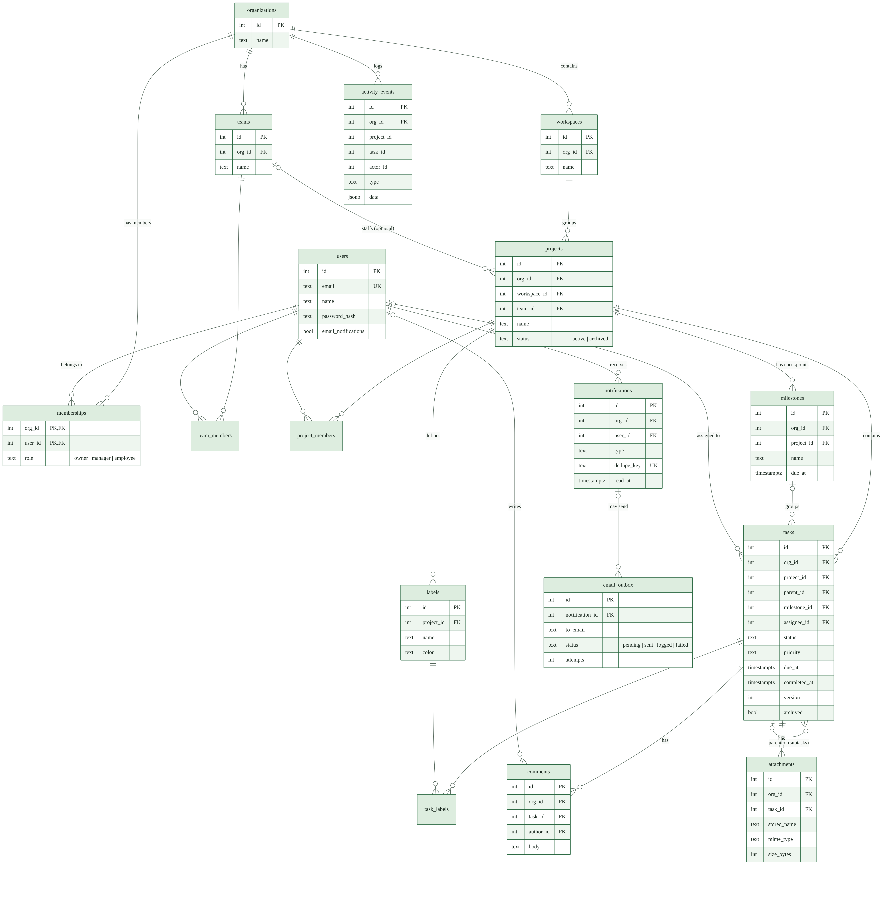

# Data model



The diagram is drawn from the real schema. The tables themselves are created by plain SQL in `database/migrations/`.

## The hierarchy

```
Organisation ─┬─ Membership (user + role: owner | manager | employee)
              ├─ Team ── team members
              └─ Workspace ── Project ─┬─ Project members
                                       ├─ Milestone
                                       ├─ Label
                                       └─ Task ─┬─ Subtasks (tasks with parent_id)
                                                ├─ Labels, Comments, Attachments
                                                └─ belongs to at most one Milestone
```

Activity events, notifications and the email outbox hang off the organisation and point at projects and tasks.

## Rules the database enforces (not just the code)

| Rule | How |
|---|---|
| A project, task, comment, attachment, label or milestone can never point at a parent in another organisation | Every such row carries `org_id`, and composite foreign keys such as `(project_id, org_id) → projects(id, org_id)` |
| A project's workspace is in the same organisation | `(workspace_id, org_id) → workspaces(id, org_id)` |
| A task's milestone is in the same project | `(milestone_id, project_id) → milestones(id, project_id)`; deleting a milestone clears only `milestone_id` |
| Status, priority, role and email status are always valid values | `CHECK` constraints |
| The same alert is never created twice | `notifications.dedupe_key` is `UNIQUE`; emails are only queued for newly inserted notifications |
| Removing a user does not delete the work | `ON DELETE SET NULL` on assignee, author and uploader |

## Fields that drive the metrics

| Field | Meaning |
|---|---|
| `tasks.parent_id` | Set for subtasks. Metrics count only top-level tasks. |
| `tasks.archived` | Soft delete. Archived tasks are left out of every metric and every list. |
| `tasks.due_at` | `timestamptz` (UTC). A date picked in the browser is stored as 23:59 local time that day. |
| `tasks.completed_at` | Set by the server when a task moves into Done (only if it was not already done); cleared when it moves out. |
| `tasks.priority` | Also the weight for weighted progress: urgent 4, high 3, medium 2, low 1. |
| `tasks.version` | Goes up on every change. A save that sends an older version gets `409 Conflict`. |
| `tasks.position` | A decimal, so a card can be dropped between two others without renumbering the column. |

## Migrations

| File | Adds |
|---|---|
| `001_init.sql` | Users, organisations, memberships, teams, projects, tasks, labels, comments, attachments, activity, notifications |
| `002_workspaces_milestones_email.sql` | Workspaces (existing projects move into a "General" workspace), milestones, email outbox, email preference |

Migrations run automatically at start-up and are recorded in `schema_migrations`, so each runs once. `tests/features.test.ts` checks that 002 upgrades a database created with only 001.
