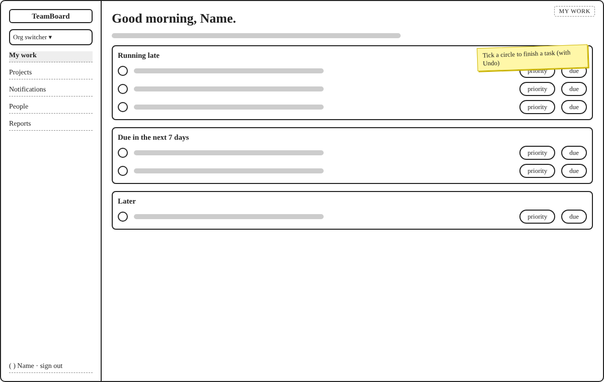
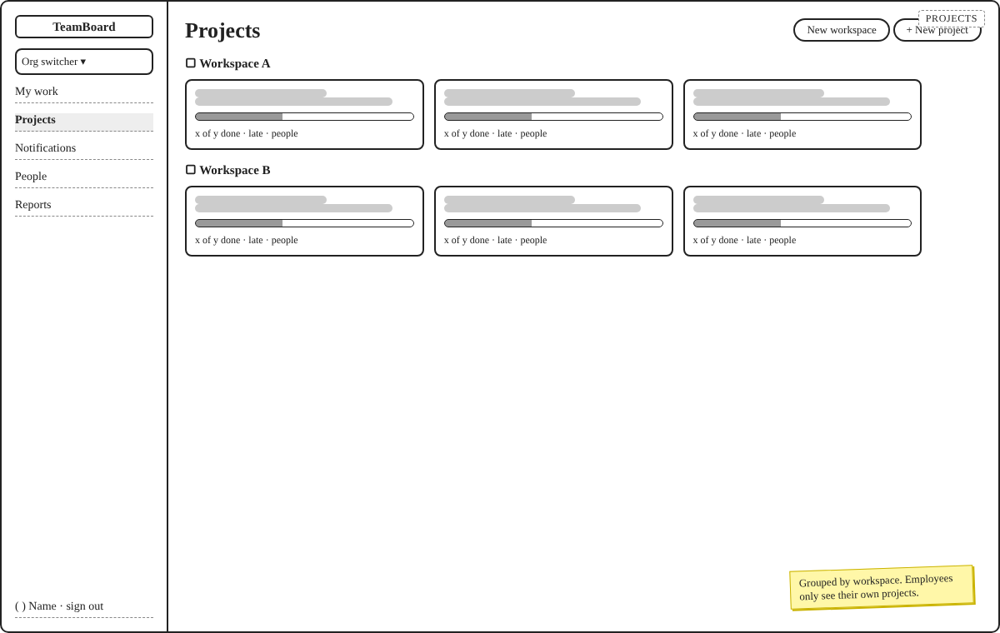
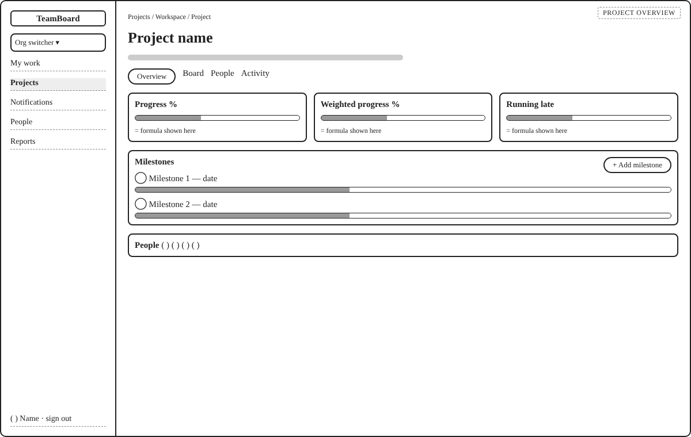
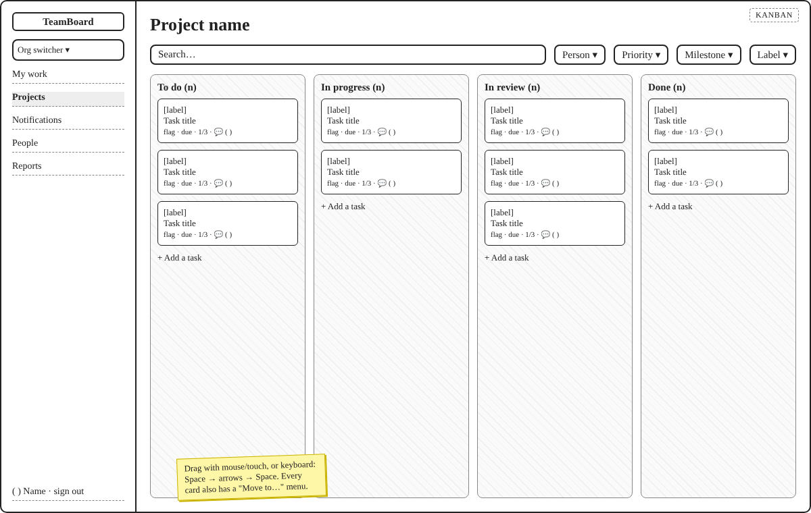
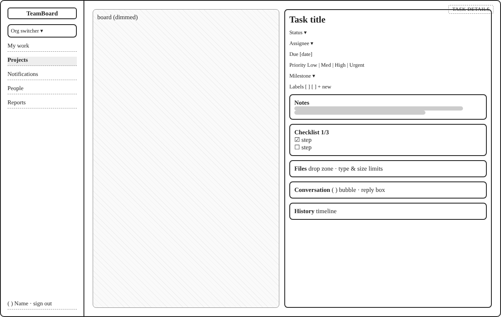
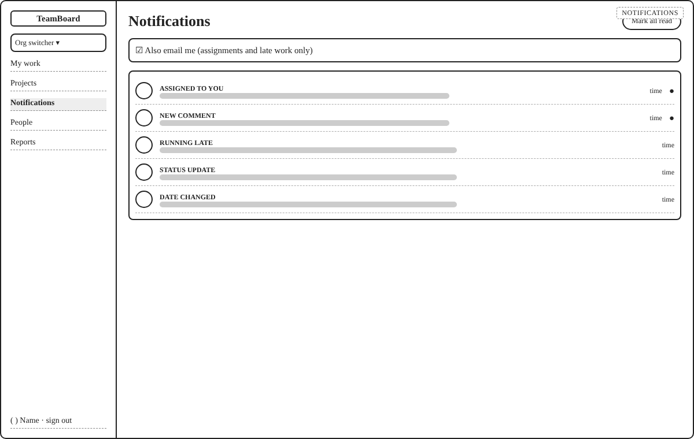
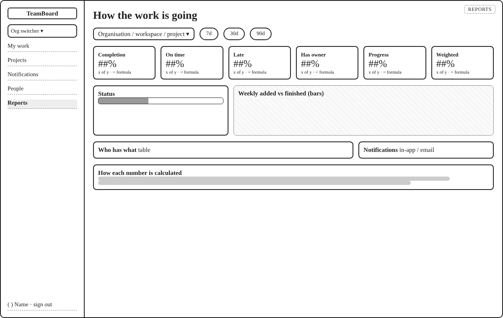

# Wireframes

Low-fidelity wireframes for the seven pages the brief suggests. They show layout and content only — no colour or final styling. Screenshots of the finished screens are in `docs/screenshots/`.

> These were drawn as documentation of the page structure. If your course expects wireframes from Week 1, say honestly when they were made.

| # | Page | What it answers |
|---|---|---|
| 1 |  | What should I do next? Late work first. |
| 2 |  | What projects exist, grouped by workspace, and how far along are they? |
| 3 |  | Progress (plain and weighted), milestones, and who is on the project |
| 4 |  | Where is each task? Move it by drag, keyboard or menu. |
| 5 |  | Everything about one task: fields, checklist, files, conversation, history |
| 6 |  | What changed that involves me? Email on or off. |
| 7 |  | How is the work going, and how is each number calculated? |
